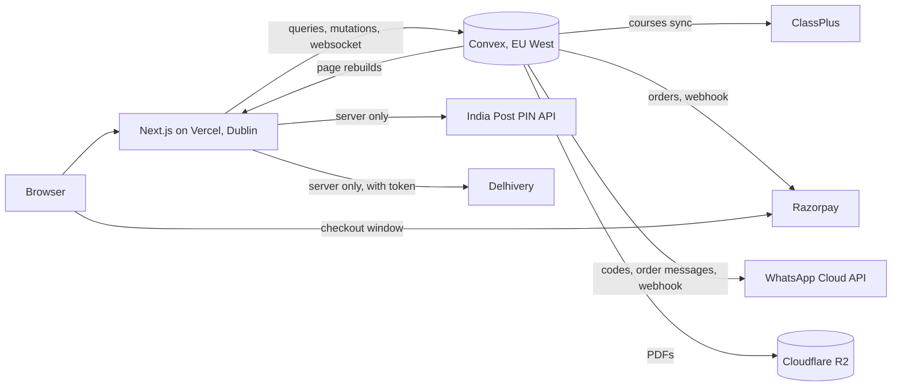

# Production readiness

As of 29 October 2026, branch `feat/launch`. What the system is, what stands
between it and a live site, in what order, and how to choose when two things
compete. Configuration detail lives in `docs/production.md`; what ICT sends
lives in `docs/ict-drive-handover.md`.

## 1. How it fits together

- **Pages** are static and rebuilt on change: Convex posts to
  `/api/revalidate` when a course syncs, a post is published or a promotion
  starts. A visitor never waits on Convex for a public page.
- **Convex** holds everything that changes: people and enquiries, the shop,
  orders, posts, promotions, settings. Sign-in (Better Auth) runs there too;
  every rule is checked in a mutation, never only in the browser.
- **Files:** images in Convex storage; PDFs in R2, uploaded by the browser on
  a signed link and read on a one-hour link. A weekly job (Sunday night)
  deletes files nothing uses any more, after their restore window.
- **Decisions already made** (docs/adr): one person record verified by
  WhatsApp (0001); courses sell on ClassPlus, books here (0002); the reader
  serves page images (0003); enquiries reach Convex through an authenticated
  route (0004); an order exists only once paid (0005).

The shape is right for a coaching centre's traffic for years: no servers to
run, one database, pages served from the edge. Nothing here needs rebuilding
before launch.

## 2. Where it stands

| Area                                                       | State                                                                                 |
| ---------------------------------------------------------- | ------------------------------------------------------------------------------------- |
| Public site, both languages                                | Built; copy needs a native Assamese read                                              |
| Courses, finder, older batches                             | Built, synced from ClassPlus                                                          |
| Books shop, checkout, all-India delivery                   | Built; waits on Razorpay keys (falls back to ordering on WhatsApp)                    |
| Free notes and reader (R2)                                 | Built; waits on the R2 bucket (falls back to page images)                             |
| Blog, RSS, exam-linked courses                             | Built; needs ICT's posts                                                              |
| Admin: enquiries, orders, shop, promotions, blog, settings | Built                                                                                 |
| Sign-in by WhatsApp code                                   | Built; waits on ICT's number and Meta's template approval                             |
| SEO and AI search                                          | Built (sitemap, structured data, llms.txt, IndexNow); off until `SITE_INDEXABLE=true` |
| Tests                                                      | 587 passing; no-Convex build passes                                                   |

## 3. Launch blockers, in order

Each line names who does it. Nothing on this list is code.

1. **ICT:** domain log-in, Razorpay KYC, the WhatsApp SIM and Meta Business
   access, Google Business Profile access, Delhivery account and token.
2. **ICT:** the "send first" folder in the handover (centre photos, teacher
   portraits, book covers, the facts sheet) and a yes on the four policies.
3. **Us:** create the Convex production deployment in EU West and set its
   variables (production.md, steps 1 to 4). The region cannot change later.
4. **Us:** Vercel production variables, Turnstile, build command (steps 5
   to 7).
5. **Us, with ICT:** WhatsApp sending number and the code template submitted
   to Meta (approval takes a day or two: start it first, it gates sign-in).
6. **Us:** Razorpay test mode end to end, then live keys and webhook.
7. **Us:** R2 bucket, token and CORS; upload one note and read it on a phone.
8. **Us:** merge #18, deploy, run `people:bootstrapOwner` with the owner's
   number, then the manual checklist (deliverables.md §6) on a real phone.
9. **Us:** `SITE_INDEXABLE=true`, Search Console (sitemap, both languages),
   Google Business Profile hours and website link.

## 4. First month after launch

- **Delhivery shipments from admin:** create the parcel and waybill from the
  order (Delhivery's order creation API), so staff stop typing waybills.
- **Refund from admin:** refund through Razorpay's API instead of its
  dashboard; today's path works, this saves a step.
- **Real content:** replace the six video-frame photos, add 5 to 10 posts
  tagged with their exam, the toppers with consent.
- **Watch the numbers:** enquiries by source (admin overview), finder
  completions, checkout drop-off (PostHog, once its key is set and the
  privacy paragraph approved).

## 5. Decisions, with a recommendation each

| Decision                      | Recommendation                                                                | Why                                                                                    |
| ----------------------------- | ----------------------------------------------------------------------------- | -------------------------------------------------------------------------------------- |
| Hosting plan                  | Vercel Pro                                                                    | Hobby forbids commercial use and rate-limits deploys (we hit it on 13 Oct)             |
| Launch payments               | Razorpay live if KYC is done by launch; otherwise launch on WhatsApp ordering | The fallback is built and tested; KYC should not hold the launch                       |
| Delhivery automation          | After launch                                                                  | PIN checks and tracking links work from day one; manifesting can wait for order volume |
| Free notes, first page public | Yes                                                                           | Google and WhatsApp previews need something to show; the rest stays behind sign-in     |
| Delivery charges              | Three zones (Assam, North East, rest of India)                                | Matches how Delhivery prices; a flat rate loses money far away or overcharges Assam    |
| Analytics                     | PostHog, after the privacy paragraph is approved                              | Needed to learn what converts; the site works without it                               |

## 6. Choosing what to do next

When two things compete, the one higher on this list wins:

1. **Money and trust:** anything that can take a wrong payment, lose an
   order or an enquiry, or show something untrue (a stale batch, an unchecked
   result).
2. **Blocked launch steps:** anything on §3 that waits on us.
3. **Conversion on the busiest pages:** home, courses, a course, checkout.
   Measure first where the numbers exist.
4. **Content ICT has sent:** it decides trust more than any design work.
5. **Polish.**

Within a level, do the smaller job first. Write the decision into
`docs/adr/` when it constrains later work, as the five there do.

## 7. Before calling it live

- [ ] `bun run check` and the no-Convex build pass on the merged commit
- [ ] Deployed: CSP and security headers present (`curl -I`)
- [ ] A real phone: sign in by WhatsApp code, enquire, buy a set in test
      mode, receive the receipt and messages, collect and deliver flows
- [ ] Staff on a phone: inbox, an order through to shipped with a Delhivery
      waybill, print labels
- [ ] Lighthouse (mobile) on the live address
- [ ] Sitemap submitted; both languages indexed within a week
